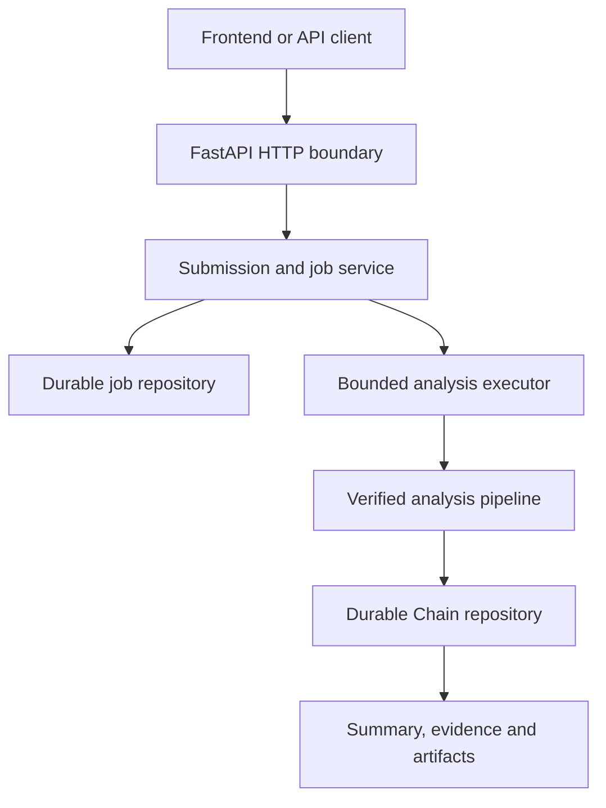

# SecureMailScope Backend V2 Implementation Plan

## Document Status

- Status: SELECTED FOR IMPLEMENTATION
- Branch: `feat/backend-v2`
- Baseline commit: `f81bcc4`
- Baseline tag: `backend-v1-public-deployed`
- Backend V2 CI commit: `94b6ac9`
- Current API compatibility baseline: `/api/v1`
- Production deployment changes: NOT AUTHORIZED
- Staging deployment: PLANNED, REQUIRES EXPLICIT APPROVAL
- Last reviewed: 2026-09-14

## Status Vocabulary

- **VERIFIED:** implemented and supported by repository evidence and tests.
- **SELECTED:** architecturally approved for implementation.
- **PLANNED:** intended, but not yet implemented.
- **DEFERRED:** deliberately postponed until prerequisites or measurements justify it.
- **OUT OF SCOPE:** excluded from the current Backend V2 delivery boundary.
- **UNVERIFIED:** must not be presented as a completed product capability.

Documentation, demonstrations and presentations must never describe a PLANNED,
DEFERRED or UNVERIFIED capability as complete.

## Blockchain and Distributed-Ledger Decision

Blockchain is not part of the SecureMailScope core architecture.

SIH26159 belongs to the combined Blockchain & Cybersecurity theme, but its
specified requirements concern passive network forensics, TLS/X.509 assessment,
AI-assisted analysis and cybersecurity reporting. It does not require a
distributed ledger.

SecureMailScope will use SHA-256 capture and Chain digests, immutable validated
analysis results, signed analysis manifests when implemented, and authenticated
audit events and database integrity controls. These mechanisms must not be
represented as blockchain.

A permissioned-ledger adapter may be evaluated later only if multiple independent
organizations must verify shared forensic chain-of-custody records without
trusting one central authority. Only signed manifest digests and safe metadata
could be anchored. Raw PCAPs, packet evidence, credentials and email data must
never be stored on-chain.

Blockchain integration is not a prerequisite for Backend V2 or SIH26159
compliance.

---

## 1. Backend V2 Mission

Backend V2 will turn the verified synchronous prototype into a staging-ready,
durable, bounded, non-blocking and extensible analysis service.

It must preserve SecureMailScope's primary differentiator:

> Every security conclusion must be traceable through a deterministic
> Chain-of-Proof to observable packet evidence, while deterministic Policy Risk
> and probabilistic ML Anomaly remain explicitly separate.

Backend V2 is not a rewrite. It extends the verified Backend V1 pipeline behind
clear interfaces and preserves existing behavior unless an additive, versioned
API change is required.

## 2. Protected Baseline

Backend V2 starts from `f81bcc4`, tagged `backend-v1-public-deployed`.

The following must remain unchanged unless the project owner explicitly approves
otherwise:

- deployed Backend V1;
- deployed Frontend V1;
- `feat/production-backend`;
- `feat/production-frontend`;
- Railway production settings;
- Vercel production settings;
- public V1 deployment URLs;
- public V1 API behavior.

Backend V2 work occurs on `feat/backend-v2`. Frontend V2 work remains on
`feat/frontend-v2`. Future integration must use a separate staging backend,
database and API URL before any production migration is considered.

## 3. Verified Backend V1 Baseline

### 3.1 Capture intake

VERIFIED:

- bounded PCAP and PCAPNG multipart upload;
- exactly one accepted multipart field named `capture`;
- allow-listed `.pcap` and `.pcapng` suffixes;
- client filename treated only as untrusted metadata;
- server-generated private temporary paths;
- bounded total body and streamed file copy;
- empty, unsupported and oversized upload rejection;
- temporary cleanup on success and failure;
- existing capture validation;
- streamed SHA-256 capture provenance;
- authoritative capinfos-derived metadata.

### 3.2 Analysis pipeline

VERIFIED synchronous pipeline implemented by `analyze_capture_to_chain()`:

1. Validate and inspect the capture.
2. Run bounded TShark analysis.
3. Reconstruct supported email sessions.
4. Adapt analyzer output into Chain-of-Proof.
5. Derive deterministic SMTP transition facts.
6. Evaluate the deterministic policy pack.
7. Validate complete Chain-of-Proof invariants.
8. Register the final validated Chain.
9. Produce API summaries and artifacts.

### 3.3 Chain-of-Proof

VERIFIED:

- strict Pydantic domain models;
- stable identifier helpers;
- canonical serialization;
- versioned JSON schema;
- graph, ownership and cross-reference invariants;
- evidence-to-session and finding-to-analysis relationships;
- conservative no-TLS attribution;
- explicit observability and limitation metadata;
- TLS 1.3 certificate non-observability without authorized session secrets;
- validation before registration and again on read.

### 3.4 Policy and ML separation

VERIFIED:

- deterministic Policy Risk and ML Anomaly have separate contracts;
- the production adapter reports `ml_engine_status=not_run`;
- no anomaly results are emitted when ML has not executed;
- policy results are not represented as machine-learning results.

### 3.5 API surface

VERIFIED routes:

- `GET /api/v1/health`
- `POST /api/v1/analyses`
- `GET /api/v1/analyses/{analysis_id}`
- `GET /api/v1/analyses/{analysis_id}/chain`
- `GET /api/v1/analyses/{analysis_id}/sessions/{session_id}/events`
- `GET /api/v1/analyses/{analysis_id}/evidence/{evidence_id}`
- `GET /api/v1/analyses/{analysis_id}/findings/{finding_id}`
- `GET /api/v1/analyses/{analysis_id}/findings/{finding_id}/artifacts/{artifact_format}`

VERIFIED behavior includes strict response models, stable machine-readable error
codes, path-safe public errors, response-size bounds, canonical JSON, JSON/HTML/PDF
artifacts, HTML security headers, exact CORS origins, dependency injection, an
empty default production repository and no production demo seeding.

### 3.6 Repository and validation baseline

VERIFIED in-memory behavior:

- bounded capacity of 32 entries;
- thread-safe registration and retrieval;
- deep-copy isolation;
- invariant validation before registration;
- byte-equivalent idempotent registration;
- explicit conflict and capacity rejection;
- no silent replacement or eviction.

Backend V2 started with:

- `uv lock --check`: PASS
- `uv run --locked ruff check .`: PASS
- `uv run --locked pytest`: PASS
- complete suite: 776 tests passed
- Backend V2 GitHub Actions workflow: PASS
- TShark and capinfos installed in CI
- no CI deployment step, secret use, OIDC write permission or repository write permission

Commits `639fd47` and `f81bcc4` completed synchronous orchestration and secure
HTTP capture upload respectively. Documentation that describes upload or
analysis orchestration as unimplemented is stale.

## 4. Current Architectural Limitations

### 4.1 Synchronous request execution

`submit_analysis()` is an async FastAPI route that directly invokes the
synchronous pipeline. TShark and Python processing can block the event loop,
clients must remain connected, and there is no queue, backpressure lifecycle or
clear interruption behavior.

### 4.2 Volatile persistence

Completed analyses exist only in process memory. Restart loses results, multiple
instances cannot share state, capacity is fixed, retention is undefined, and no
schema migration mechanism exists.

### 4.3 Missing job lifecycle

There is no durable submission resource for accepted, queued, running, completed,
failed, cancelled, interrupted or expired work. Final Chain analysis status must
not be reused as the infrastructure job lifecycle.

### 4.4 Identity and replay concerns

Backend V2 must distinguish job identity, capture content identity, analysis
configuration identity, deterministic result identity and final Chain identity.
Repeated upload of equivalent input must not create unexplained conflicts or leak
cross-tenant information.

### 4.5 Incomplete product coverage

- production-quality SMTP transition analysis exists;
- complete IMAP and POP3 transition analysis is not verified;
- no production ML training or inference pipeline exists;
- there is no authentication, authorization, tenancy, quota or IDOR boundary;
- no durable audit identity or encrypted raw-capture retention exists;
- no repository-controlled Docker, Compose, staging database, migration, worker
  or deployment runbook exists.

## 5. Product Principles

### 5.1 Evidence before conclusion

Every deterministic finding must link through facts and protocol events to capture
frames and capture provenance.

### 5.2 Honest observability

The product must distinguish observed, derived, inferred, unavailable, not
observable and not run. Absence of evidence must not become evidence of
insecurity.

### 5.3 Deterministic and probabilistic separation

Policy Risk answers which explicit security rules were satisfied or violated.
ML Anomaly answers which observable behavior differs from a learned baseline.
ML must not consume policy scores as substitute features or relabel policy
findings as AI findings.

### 5.4 Privacy and offline operation

Raw captures are deleted after analysis by default. Retention requires explicit
authorization, encryption, duration, deletion, audit logging, quota and consent.
The core pipeline must not silently depend on external AI APIs, crawlers, remote
policy services or internet access. Policy packs and models used for analysis
must be local, versioned and digestable.

### 5.5 Fail closed and remain bounded

Invalid configuration, corrupted Chains, unknown schemas, digest mismatches,
unsafe models and invariant failures must produce stable failures. Every
untrusted-input operation must have explicit bounds for bytes, fields, parser and
subprocess output, time, concurrency, queue depth, stored results, artifacts and
retention.

### 5.6 Additive compatibility

Backend V2 preserves `/api/v1`. Breaking semantics require `/api/v2` or another
explicitly versioned additive surface.

## 6. Target Architecture



The verified pipeline remains:

```text
Capture
  -> intake and provenance
  -> bounded TShark extraction
  -> session reconstruction
  -> protocol transition facts
  -> deterministic policy evaluation
  -> optional independent ML inference
  -> final invariant validation
  -> immutable Chain-of-Proof
```

Application layers will separate HTTP adapters, application services, job
lifecycle, orchestration, protocol analyzers, policy, optional ML, repository
protocols, database adapters, rendering and runtime composition. Routes must not
implement database, queue or security-policy logic directly.

Proposed package direction:

```text
src/securemailscope/
  api/
  jobs/
  storage/
  orchestration/
  protocols/{smtp,imap,pop3}/
  policy/
  ml/
```

This is a target direction, not permission for a large refactor. Existing modules
move only when a concrete boundary and tests justify the move.

## 7. Identity Model

### 7.1 Job ID

A unique public-safe identifier for one submitted execution request. It is
available after acceptance, used for lifecycle polling, and is not the final
analysis ID.

### 7.2 Capture digest

The SHA-256 digest of the exact accepted capture bytes, calculated during bounded
processing and stored as provenance. It must never reveal whether another tenant
uploaded the same content.

### 7.3 Analysis fingerprint

A canonical digest of all inputs that can affect output, including capture digest,
analyzer and Chain schema versions, exact TShark and capinfos versions, analysis
configuration, policy pack/profile, protocol plugin versions, and ML feature/model
digests plus inference-runtime identity/version when ML executes.

### 7.4 Analysis ID

The stable identity of a final validated result. A completed job links to an
analysis ID. Multiple authorized jobs may link to one deterministic result only
when complete fingerprints match and the behavior leaks no cross-tenant
information.

## 8. Durable Storage Architecture

### 8.1 Selected technology

- SQLAlchemy 2.x behind domain repository protocols;
- Alembic for explicit migrations;
- SQLite for local development and single-instance tests;
- PostgreSQL for persistent staging and later multi-instance operation.

Dependencies must be added through `uv` and committed in `uv.lock`. SQLAlchemy
models must not leak into Chain, policy, orchestration or API domain models.

### 8.2 Initial entities

`analysis_jobs` stores job ID, future owner/tenant identity, lifecycle state,
safe failure and stage, capture digest, analysis fingerprint, linked analysis ID,
timestamps, expiry, retry/lease data, configuration and policy digests, and
analyzer version.

`analysis_results` stores analysis ID and fingerprint, schema version, canonical
Chain bytes and SHA-256, creation time and optional expiry.

`audit_events` is planned for authenticated or operationally significant actions.
It must never contain packet contents, credentials or raw protocol payloads.

### 8.3 Chain storage and retrieval

Before storage: validate the Chain, serialize canonical bytes, calculate SHA-256,
and write result plus digest atomically.

After retrieval: verify the digest, reject unsupported schema versions,
reconstruct strict models, rerun complete invariants, and return an isolated
domain snapshot.

Equivalent writes remain idempotent. Different content under the same identity
fails closed. Partial Chains are never returned as completed results. Database
details never enter public responses.

### 8.4 SQLite requirements

Enable foreign keys; evaluate/document WAL; configure busy timeout; use explicit
transactions; validate database path and parent permissions; check migration
version during readiness; isolate test databases. SQLite is not a horizontally
scalable queue.

## 9. Job Lifecycle and Execution

Initial state model:

```text
accepted -> queued -> running -> completed
                             -> failed
                             -> interrupted
```

Later optional states are `cancel_requested`, `cancelled` and `expired`.
Transitions must be enforced by a closed state machine.

Safe public stages may include validating capture, queued, analyzing packets,
adapting Chain, deriving facts, evaluating policy, running ML, validating Chain,
storing result and completed. Internal exceptions, paths and packet contents are
never exposed.

The first executor is a persistent database-backed job record plus bounded
in-process executor, with maximum queue and concurrency, backpressure, graceful
shutdown and explicit interrupted-job recovery. FastAPI `BackgroundTasks` is not
a durable job system.

Redis or external workers are DEFERRED until measurements require multiple API or
worker instances, cross-process scheduling, retries or independent scaling.

## 10. API V2 Contract

`POST /api/v1/analyses` initially retains its verified synchronous behavior.

Planned additive routes:

- `POST /api/v2/analyses`: bounded upload, provenance, durable job and
  `202 Accepted` with status URL;
- `GET /api/v2/analysis-jobs/{job_id}`: state, safe stage, timestamps, safe
  failure and completed-result links.

Existing V1 read endpoints may remain authoritative until an incompatible read
contract is genuinely required.

Expected status mapping includes `201` for synchronous V1 completion, `202` for
V2 acceptance, `400/422` malformed input, `404` scoped absence, `409` conflict,
`413` size, `415` capture type, `429` rate limit and `503` capacity. Backpressure
uses `Retry-After` when meaningful.

Planned `Idempotency-Key` support must be bounded, validated, owner-scoped,
fingerprinted and retained for a documented duration. OpenAPI models remain
strict, lifecycle enums closed, error shapes documented and frontend contracts
checked.

## 11. Event-Loop Isolation

Blocking orchestration must run in a bounded thread or worker context. Async
upload remains bounded; temporary captures survive secure handoff and are deleted
after success or failure; client cancellation cannot create unsafe orphans;
health/read requests remain responsive; concurrency tests prove isolation.
TShark time and output limits remain enforced.

## 12. Protocol Plugin Architecture

SMTP, IMAP and POP3 share capture, TCP and TLS foundations while keeping
protocol-specific transitions separate. Each plugin defines content-based
classification, allow-listed TShark fields, normalization, transitions, fact
derivation, limitations, tests and version metadata. Ports are hints, never
authoritative proof.

SMTP preserves verified EHLO/HELO, STARTTLS offer/request/acceptance, TLS
negotiation/establishment, cleartext continuation and failure/downgrade facts.

IMAP PLANNED: CAPABILITY, STARTTLS capability/command/acceptance/rejection, TLS
establishment, observable pre-TLS authentication risk and limitations.

POP3 PLANNED: CAPA, STLS capability/command/acceptance/rejection, TLS
establishment, observable pre-TLS authentication risk and limitations.

Truncated, encrypted, incomplete or unsupported sessions produce limitations,
not fabricated conclusions.

## 13. Cryptographic Posture Expansion

Planned evidence-backed facts and checks include TLS version, cipher suite,
key-exchange observability, Forward Secrecy, STARTTLS/STLS transitions,
cleartext fallback, handshake failure, deprecated configurations, and certificate
chain/validity/hostname/trust properties only when sufficient inputs exist.

The product must distinguish negotiation observed, encryption established,
certificate observed, certificate validation performed, validation unavailable
and certificate not observable. Passive capture analysis is not active scanning.
TLS 1.3 certificate limitations remain explicit without authorized secrets.

## 14. Policy Pack Lifecycle

Each policy pack will carry ID, semantic and schema versions, profile, digest,
effective date, sources, supported protocols, minimum analyzer version, rule IDs
and deprecations.

Updates use a separate controlled workflow: retrieve authoritative guidance,
normalize candidate rules, human-review them, validate schema, run regression
fixtures, version and digest the pack, optionally sign it, and distribute a
trusted offline bundle. Live crawling never decides an uploaded capture result.

Every analysis records exact policy pack, profile, analyzer and configuration
identity.

## 15. Independent ML Anomaly Engine

ML is for behavioral anomaly detection, not deterministic compliance judgment.
The selected initial family is an offline-trained Isolation Forest with a
versioned feature schema and trusted local model.

Features may include session/duration distributions, protocols, TLS-upgrade and
failure ratios, cleartext continuation, TLS/cipher distributions, retries,
transition sequences and safe timing patterns. Policy scores, severities and
recommendation priorities must not be used to reproduce policy output.

Uploaded models are forbidden. Trusted model digests, feature compatibility,
Python/scikit-learn versions and safe loading are required. Evaluation must cover
data separation, leakage, false positives, capture sizes, environments,
synthetic-versus-real limitations and reproducibility.

When inference does not execute:

```text
ml_engine_status = not_run
anomaly_results = []
```

## 16. Chain-of-Proof Differentiators

Every completed analysis exposes a reproducible manifest with capture and Chain
digests, analyzer/TShark/capinfos/schema versions, policy identity, optional ML
identity, configuration, plugin versions and limitations.

Dashboard, JSON, HTML and PDF derive from the same validated Chain snapshot.
Renderers never independently recalculate conclusions. Stored and exported Chains
support digest verification; signed Ed25519 manifests and an external verifier
are later enhancements.

Zero-black-box navigation remains:

```text
Finding
  -> rule evaluation or anomaly result
  -> derived fact
  -> protocol event
  -> evidence record
  -> capture frame and capture digest
```

## 17. Security Architecture

Treat capture bytes, multipart structures, filenames, headers, identifiers,
database bytes, untrusted policy/model files, rendered text and configuration as
untrusted.

Required mitigations include allow-listed subprocess arguments and fields, no
shell interpolation, time/output/upload/queue/concurrency limits, private
temporary storage, path traversal prevention, redacted public errors, HTML
escaping/headers, exact CORS, parameterized database access, digest/schema checks,
trusted-only models, and no packet content or credentials in logs.

Before public staging, provide a staging access token, platform protection or
authenticated application session. Full multi-user operation later requires
identity, ownership, authorization, quotas, audit events, retention controls and
IDOR tests.

## 18. Observability

Structured logs may contain request, job and analysis IDs; lifecycle transitions;
safe stage and duration; safe result category; TShark exit classification; and
policy/model versions. They must not contain payloads, credentials, email content,
tokens, temporary paths in public logs or full untrusted filenames.

Separate liveness from readiness. Readiness checks database/schema, TShark,
capinfos, policy validity and writable temporary storage. Optional disabled ML
does not make readiness fail.

Metrics cover bounded operational counts, queue depth, jobs, stage/analysis time,
timeouts, storage failures, artifacts and ML inference/failures. Never use
unbounded labels such as raw analysis IDs.

## 19. Deployment and Packaging

The planned container uses a pinned Python base, locked `uv` dependencies,
non-interactive TShark/capinfos, a non-root user, no live-capture capabilities,
bounded temporary storage, an explicit command and health check, minimal runtime
packages and no embedded secrets.

Local Compose may include API, worker when separated, PostgreSQL when required,
persistent volume, safe environment example and health dependencies.

Staging remains independent: separate Railway service, database/volume,
environment, CORS origin, backend URL, Frontend V2 API URL and access protection.
Creating or modifying staging resources requires explicit approval.

Production promotion requires green CI, backup/rollback, migration and security
review, staging E2E evidence, limits, a runbook and explicit owner approval. No
automatic Backend V2 production deployment is authorized.

## 20. Frontend V2 Integration Contract

Frontend V2 must support capture selection/upload, accepted jobs, polling,
completed analysis identity, summary, Chain, sessions/events/evidence/findings,
recommendations, separate Policy/ML state, JSON/HTML/PDF artifacts, limitations,
safe retry and expiry.

It must not manufacture completed data for queued, running, failed, expired,
unavailable or `not_run` states. Demo/mock mode remains visibly distinguishable
from real staging analysis.

## 21. Testing Strategy

Unit tests cover lifecycle transitions, fingerprints, serialization, digests,
error mapping, idempotency, protocols, policies, ML feature validation and
configuration.

Contract tests cover strict schemas, OpenAPI, status/error codes, Policy/ML
separation, frontend-required fields and V1 compatibility.

Every repository adapter must pass the same suite: registration/retrieval,
isolation, invariant rejection, idempotency, conflict, missing/capacity,
corruption, digest/schema mismatch, concurrency, rollback and restart persistence.

Job tests cover success/failure, capacity, duplicates, invalid transitions,
interruption/recovery, graceful shutdown, storage failure and temporary cleanup.

Security tests cover path traversal, malformed multipart, all upload bounds,
duplicate/extra fields, invalid capture/type/identifier, TShark failure/timeout,
HTML injection, CORS, future cross-owner access, untrusted models and corrupted
storage.

Real-tool integration fixtures cover SMTP cleartext, STARTTLS success/rejection/
fallback, multiple sessions, truncation, invalid capture, TLS 1.2 certificate
visibility and TLS 1.3 limitations, followed later by IMAP and POP3.

Staging E2E proves upload through job, durable result, dashboard navigation and
artifacts. Performance measurements establish memory, latency, concurrency,
queue, database and artifact baselines; targets are measured, not invented.

## 22. CI and Supply-Chain Quality

CI continues:

```text
uv lock --check
uv sync --locked --dev
uv run --locked ruff check .
uv run --locked pytest
```

Python comes from `.python-version`; uv and actions are pinned; `uv.lock` is
committed; permissions are read-only; TShark/capinfos install non-interactively;
concurrency cancellation is enabled; no deployment, secrets or OIDC writes exist.

Later gates include migrations, Docker build, OpenAPI snapshots, dependency and
container scanning, SBOM, secret scanning, and an explicitly authorized staging
smoke workflow.

## 23. Documentation Truth Reconciliation

Review `AGENTS.md`, `MASTER_PROMPT.md`, `context/project-overview.md`,
`context/progress-tracker.md` and `context/architecture.md`.

Preserve clearly historical statements; record Commit 6A orchestration and 6B
upload as verified; state that V1 ends at `f81bcc4` and V2 CI begins at `94b6ac9`;
identify synchronous execution and in-memory persistence as current gaps; and do
not claim durable storage, background jobs, ML, authentication, complete
IMAP/POP3 or staging before verification.

## 24. Competitive Architecture Amendments

These requirements are derived from review of Zeek, Corelight, Arkime, Suricata,
Wireshark/TShark, Malcolm and active email/TLS assessment tools. They extend the
plan without changing its protected baseline or first code milestone.

### 24.1 Specialization boundary and four evidence lanes

SecureMailScope remains an evidence-backed email cryptographic-posture product,
not a general NDR, IDS, full-packet search engine or universal analyzer.

Four lanes remain separate:

1. Wire Evidence from capture provenance, sessions, transitions, TLS/certificates,
   frames and capture limitations.
2. Published/Configuration Evidence such as imported versioned MTA-STS, TLS-RPT,
   DANE/TLSA, DNSSEC, MX, administrator configuration and authorized probes.
3. Deterministic Policy Risk.
4. Independent ML Anomaly.

Published/configuration evidence is imported as a versioned snapshot; the offline
core never silently retrieves it. Discrepancy findings identify the disagreeing
lanes, evidence, deterministic/probabilistic nature and limitations.

### 24.2 Assessment Coverage

Assessment Coverage is first-class and separate from job status, analysis status,
Policy Risk and ML Anomaly.

Inputs may include capture format/duration/link type/snap length, reported drops,
truncation, TCP gaps, missing direction, midstream start, handshake boundaries,
opaque segments, unsupported protocols, analyzer violations, unavailable fields,
session completeness and per-check evidence sufficiency.

Initial states:

```text
sufficient
partial
insufficient
not_observable
```

Coverage states never become security scores. Each state carries reason codes,
scope, supporting references and remediation such as recapturing from a better
network point. Initial capture-level and session-level contracts are P0 because
false certainty would undermine every later result.

### 24.3 Searchable analysis catalog

After durable persistence, provide a scoped catalog with cursor pagination and
indexed relational projections for safe fields such as timestamps, protocol,
job/result state, policy severity, coverage state, TLS version, cipher family,
certificate fingerprint and safe endpoint metadata.

Search APIs must enforce ownership, bounds, stable ordering and filtering. Do not
query raw canonical Chain blobs for operational search. PostgreSQL indexes are the
selected default; OpenSearch is deferred until measured volume, latency or query
complexity proves relational projections insufficient.

### 24.4 Cross-analysis comparison and posture drift

Comparison must use stable normalized dimensions and expose changed, unchanged,
new, resolved and incomparable facts/findings. It records both analysis manifests,
policy/configuration/plugin versions and coverage differences so tool changes are
not mislabelled as infrastructure drift.

Comparison is added after durable results and stable fingerprints exist. Missing
or insufficient evidence produces an incomparable/limited result, never an
invented improvement or regression.

### 24.5 Versioned plugin compatibility

Record protocol plugin IDs/versions, compatible analyzer/Chain schema versions,
allow-listed TShark fields, minimum TShark version, configuration digest and
known limitations. Readiness and fixtures validate compatibility.

Arbitrary executable third-party plugins are deferred. Initially, plugins are
trusted repository code with explicit registration and tests.

### 24.6 Cross-tool pivots and interoperability

Preserve capture timestamps, frame numbers and flow attributes. Where derivation
is technically sound, support Community ID and copyable Wireshark display filters
so analysts can pivot to existing tools.

Later exports may include stable NDJSON operational events and common security
event mappings. Every exported record retains analysis/capture provenance, stable
rule IDs/revisions and bounded allow-listed fields. Imported Zeek, Suricata or
Arkime records may enrich evidence but never silently replace native analysis.

### 24.7 Immutable investigation overlay

Analyst workflow data—triage state, assignment, notes, disposition and timestamps—
must be stored separately from immutable analysis results. Notes and dispositions
never rewrite the Chain, evidence, policy finding or ML output. Authenticated
actor identity, optimistic concurrency and audit events are required before this
becomes multi-user.

### 24.8 Explicit scale triggers

The following remain deferred until measurements justify them:

- OpenSearch or another external search engine;
- separate/distributed workers and external broker;
- distributed sensors or live capture;
- object storage for retained raw PCAPs;
- agentic AI or automatic containment;
- full NDR/IDS behavior.

Trigger decisions use measured stored-result volume, query p95 latency, queue
depth, job p95 duration, concurrency, database size and operational complexity.
The decision and threshold evidence must be recorded in an ADR before adoption.

### 24.9 Priority placement

- **P0 before staging:** capture/session coverage contracts, manifest/plugin
  identity, durable storage, async lifecycle, safe catalog foundations.
- **P1 after durable async foundations:** searchable catalog, comparison/drift,
  cross-tool pivots and single-user investigation metadata.
- **P2 after prerequisites and measurements:** distributed search/execution,
  multi-user overlay, external-record ingestion and optional ledger anchoring.

These additions do not expand V2-1 beyond identity and repository contracts.

## 25. Implementation Milestones

### V2-0 — Truthful Architecture Baseline

Reconcile the five stale documents, record verified routes and V1/V2 boundaries,
and add initial ADRs including blockchain exclusion. Acceptance: documents agree,
no false claims, full CI green.

### V2-1 — Identity and Repository Contracts

Define result reader/registry and job repository protocols, storage errors,
analysis fingerprints, manifest/plugin identity, repeated-upload semantics and
shared repository behavior tests. Keep in-memory compatibility; introduce no
database leakage.

### V2-2 — Durable Result Repository

Add SQLAlchemy, Alembic, relational schema, canonical Chain storage/digest checks,
SQLite adapter, PostgreSQL-compatible schema, restart/corruption tests and the
initial indexed projection boundary.

### V2-3 — Event-Loop Isolation

Move blocking orchestration to bounded execution while preserving V1 behavior and
temporary cleanup. Prove health/read responsiveness with concurrency tests.

### V2-4 — Durable Job Lifecycle

Implement states, transitions, durable jobs, bounded executor, capacity,
backpressure, recovery and safe failures. Store only validated final results.

### V2-5 — Async API

Expose V2 submission and polling, strict models, status/result links, polling and
optional idempotency. Preserve `/api/v1`.

### V2-6 — Staging Security and Operations

Add environment settings, liveness/readiness, exact CORS, redacted logs,
correlation, limits, staging access protection, migrations and non-root Docker.
No production setting changes.

### V2-7 — Frontend V2 Staging Integration

With explicit deployment approval, create separate staging resources and prove
real upload, polling, restart persistence, result navigation, Policy/ML separation
and artifact parity end to end.

### V2-8 — IMAP and POP3 Expansion

Implement protocol contracts, content classification, transitions, fixtures and
real-tool tests with evidence-backed limitations.

### V2-9 — Cryptographic Depth

Normalize TLS/cipher/KEX/Forward-Secrecy and observable certificate facts; add
rules and evidence links while preserving passive-analysis limitations.

### V2-10 — Policy Supply Chain

Implement manifests, sources, versions/digests, compatibility, offline updates,
regression fixtures and optional signed bundles.

### V2-11 — ML Anomaly Baseline

Implement feature schema, offline data/training, Isolation Forest, trusted model
registry/manifest, bounded inference, separate results and evaluation report.

### V2-12 — Authentication and Tenant Isolation

Add threat model, identity, ownership, authorization, quotas, audit events,
retention controls and IDOR/deduplication tests.

### V2-13 — Scale-Out Architecture

Trigger-based and DEFERRED. Only measured need may introduce production
PostgreSQL configuration, separate workers, external queues, leasing/retries,
object storage, horizontal API scaling or distributed metrics.

Catalog search, comparison/drift, cross-tool pivots and investigation overlay are
introduced incrementally after their persistence/lifecycle prerequisites; they do
not delay V2-1.

## 26. Standout Product Capabilities

Architectural targets include evidence-backed Chain-of-Proof, deterministic email
transition state machines, honest TLS observability, Policy/ML separation,
reproducible fingerprints/manifests, artifact parity, privacy-first deletion,
offline operation, versioned policy and protocol plugins, coverage confidence,
indexed investigations, posture drift, cross-tool pivots and integrity-verifiable
exports. Only VERIFIED items may be presented as completed.

## 27. Explicit Non-Goals for Initial Backend V2

- live or privileged packet capture;
- unauthorized email decryption;
- phishing detection, malware detonation, blocking or automatic remediation;
- SIEM/SOAR integration or geolocation;
- external AI APIs or silent internet dependencies;
- Kubernetes or premature microservices;
- distributed queues/search before measurements;
- arbitrary executable plugins;
- full NDR/IDS scope;
- raw-PCAP retention by default;
- production ML claims without evaluation;
- public multi-user access without authorization;
- blockchain as a core requirement.

## 28. Definition of Done

Backend V2 core is complete only when documentation is truthful; durable results
survive restart; blocking analysis leaves the event loop; lifecycle and capacity
are explicit; corrupt storage fails closed; V1 compatibility is preserved or
versioned; staging works end to end; Policy/ML remain separate; raw captures are
deleted by default; security and real-tool tests pass; Docker staging is
reproducible; and no deployed V1 service changed without explicit approval.

Competitive follow-ons are complete only when coverage never implies false
certainty, search is scoped/bounded/indexed, comparisons expose version and
coverage differences, plugins are compatibility-checked, investigation metadata
cannot mutate evidence, and scale-out remains measurement-gated.

## 29. Immediate Next Action

The first implementation action is V2-0 documentation reconciliation. No database
dependency, API behavior, deployment setting or production service changes until
that baseline is reviewed and committed.

The first code milestone after V2-0 is V2-1:

> Define identity, analysis fingerprint, manifest/plugin identity, job and durable
> repository contracts with focused tests before implementing database adapters or
> application wiring.

Do not begin with SQLAlchemy, Alembic, asynchronous routes, deployment or a broad
module refactor.
